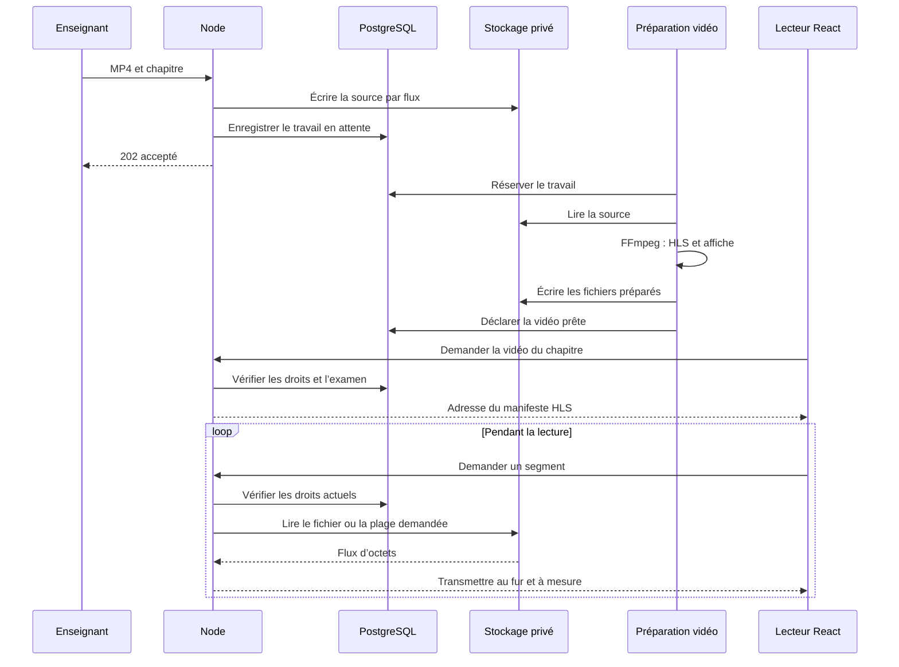

# Vidéos : lecture et stockage

## Parcours enseignant et apprenant

L’enseignant joint un MP4 à un chapitre enregistré d’un cours en brouillon. Le serveur contrôle le propriétaire, la révision, la taille et le format. L’envoi est limité à **1 Go** et le traitement accepte une durée maximale de **deux heures**.

La vidéo passe par `QUEUED`, `PROCESSING`, puis `READY` ou `FAILED`. La publication attend que tous les chapitres vidéo disposent d’un fichier prêt. Le retrait et le remplacement exigent un brouillon et une révision à jour.

L’apprenant utilise Video.js avec lecture HLS, vitesse, qualité, volume, plein écran et image dans l’image lorsque le navigateur le permet. Les chapitres précédent et suivant viennent du programme reçu du serveur.

## Trajet des fichiers



Le navigateur charge un manifeste `.m3u8`, puis des segments d’environ six secondes. Il n’attend pas le MP4 complet. Un déplacement dans la vidéo demande les segments correspondants ; le tampon du lecteur reste limité.

L’enseignant envoie néanmoins le MP4 entier une fois. Le serveur le place temporairement sur disque, puis le transmet au stockage sans conserver le film en mémoire. La préparation asynchrone relit la source et supprime ses fichiers temporaires après traitement.

Les sorties utilisent H.264/AAC, avec deux qualités au maximum à 720 et 360 pixels, sans agrandir la source. La source reste privée. Une plage valide répond `206` avec `Content-Range` ; une plage impossible répond `416`. Node transmet le flux au rythme du destinataire.

## Stockage indépendant du fournisseur

Le port `VideoStorage` se trouve dans `apps/api/src/application/video-storage.ts` :

| Membre                                | Rôle                                        |
| ------------------------------------- | ------------------------------------------- |
| `driver`                              | Nom du fournisseur enregistré avec la vidéo |
| `ready()`                             | Vérifier sa disponibilité                   |
| `write(key, stream, size, mediaType)` | Écrire un flux                              |
| `read(key, range?)`                   | Lire un flux ou une plage                   |
| `remove(key)`                         | Retirer un objet                            |

Les adaptateurs MinIO/S3 et WebDAV implémentent ce port. Le domaine, les règles d’apprentissage et le lecteur ne dépendent pas de leur SDK. Le navigateur reçoit uniquement des adresses EduTube, jamais les accès au stockage.

Pour ajouter un fournisseur, implémenter le port puis l’enregistrer dans `configuredVideoStorages`, dans `apps/api/src/adapters/storage/video-storages.ts`. Conserver les lectures par flux et la gestion des plages.

`VIDEO_STORAGE` choisit le fournisseur des **nouvelles** vidéos. Les vidéos existantes gardent leur `storage_driver`. Changer cette variable ne déplace aucun fichier. Une migration exige de copier la source et les fichiers référencés par `video_assets`, vérifier leur intégrité, puis mettre à jour leur association en base. Garder l’ancien adaptateur pendant la transition.

## MinIO local

`make services` démarre MinIO. La console est sur [localhost:9041](http://localhost:9041), l’API sur `9040`. Les accès de développement sont `edutube-local` / `edutube-local-secret`, définis dans `.env.example`. Le bucket `edutube-videos` est privé et persiste dans le volume `minio_data`.

En lancement local, `MINIO_ENDPOINT` pointe vers l’hôte. Dans Docker, Compose utilise `http://minio:9000`. Ne pas publier le bucket ni transmettre ses identifiants au front.

## Branchement WebDAV

Dans `.env`, pour un lancement local :

```dotenv
VIDEO_STORAGE=webdav
WEBDAV_URL=https://cloud.example/remote.php/dav/files/compte/edutube-videos
WEBDAV_USER=compte
WEBDAV_PASSWORD=mot-de-passe-application
```

Créer le dossier privé et limiter le compte de service à ce dossier. Utiliser l’adresse WebDAV fournie par l’installation concernée. `WEBDAV_TOKEN` remplace l’identifiant et le mot de passe si le serveur accepte un jeton Bearer.

L’adaptateur crée les collections, dépose par `PUT`, lit par `GET` avec `Range` et retire par `DELETE`. Il refuse les redirections pour protéger les accès. Son contrat est testé contre un serveur de test ; vérifier une installation ownCloud réelle avant de l’utiliser pour une bibliothèque.

## Examens et sécurité

Un cours possède un quiz. Dans le brouillon, choisir le score minimum et cocher le verrou sur le chapitre concerné. Ce chapitre et les suivants exigent une réussite pour le compte connecté et la révision actuelle du quiz. Un chapitre verrouillé ne peut pas être un aperçu public.

Le serveur applique le même contrôle aux leçons, segments, documents, notes et validations. Modifier l’adresse ou conserver un lien ne contourne pas le verrou. Changer la révision du quiz exige une nouvelle réussite.

L’enseignant propriétaire conserve son aperçu. Les régulateurs et super-admins passent par les routes de contrôle administratif, journalisées. Il s’agit d’un contrôle de progression pédagogique, sans surveillance d’examen ni protection contre la capture d’écran.

## Traitement et limites

La file PostgreSQL utilise des réservations renouvelées, trois tentatives et des dossiers d’objets distincts. Une tentative devenue ancienne ne peut pas publier son résultat. Un retrait pendant le traitement empêche la vidéo de devenir disponible. FFmpeg n’accepte pas de source réseau fournie par le fichier et ses traitements sont bornés.

Node porte actuellement la bande passante de lecture. Une passerelle ou un CDN demanderait de préserver les mêmes droits et de définir la durée de validité des accès. L’envoi n’est pas reprenable par blocs. La purge des objets abandonnés et la durée de conservation restent à définir. La lecture hors connexion, les sous-titres enseignants et la reprise à la seconde exacte ne sont pas implémentés ; la reprise au chapitre est conservée.

## Données de démonstration

Démarrer le projet et ses comptes de test, puis lancer `make videos-demo`. La commande exerce les mêmes routes HTTP que l’enseignant et conserve l’identifiant du cours dans `data/demo-videos/course.json` pour les lancements suivants.

Les trois extraits de 24 secondes proviennent de **Big Buck Bunny — © 2008 Blender Foundation / www.bigbuckbunny.org**, sous [Creative Commons Attribution 3.0](https://peach.blender.org/about/), depuis le [téléchargement officiel](https://peach.blender.org/download/). Les crédits figurent aussi dans les chapitres. `nouveau@edutube.test` permet d’essayer le verrou avant réussite de l’examen.
